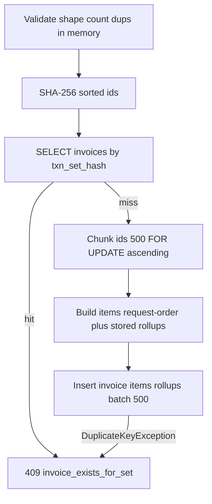

# Travel transactions + frozen invoice API (spec v2)

This plan **replaces v1**. Follow the v2 build spec exactly except **Java 21 + Spring Boot 4.1.x** (ignore the spec’s Boot 3.x line). Do not add OCR, auth, Redis/Kafka, Idempotency-Key headers, payload hashes, audit logs, or LLM calls.

Project root: [`/Users/vikramjeetsingh/task-b`](/Users/vikramjeetsingh/task-b). Keep fixtures.

## Product

- **Transaction** = live editable charge until billed. **Invoice** = frozen snapshot; later txn edits never change it.
- **`total` is GROSS.** Never add tax/fee lines on top. Invoice total = sum of included `total`s (`Math.addExact` on minor units).
- **navan_fee** is a first-class transaction, not a `fee_line`, not in `fee_rollup`.
- Do not validate `total == fare + taxes + fees`.



## Stack (DECISIONS, Boot 4 override)

- Java 21, **Spring Boot 4.1.x**, Maven wrapper
- Web + validation + **Spring JDBC** (`JdbcClient` / `NamedParameterJdbcTemplate`), `batchUpdate`. **No JPA / Flyway**
- H2 file: `jdbc:h2:file:./data/travel;MODE=PostgreSQL;DB_CLOSE_DELAY=-1;LOCK_TIMEOUT=5000`
- Tests: `jdbc:h2:file:./target/testdb-<random>` — **never** `mem`
- Isolation **READ_COMMITTED** (do not change). SQL Postgres-portable. Generated keys: `BIGINT GENERATED BY DEFAULT AS IDENTITY` (not `AUTO_INCREMENT`)
- Hikari `maximum-pool-size=10`
- `schema.sql` + `spring.sql.init.mode=always`
- Jackson `USE_BIG_DECIMAL_FOR_FLOATS`
- HTTP tests: `@SpringBootTest(RANDOM_PORT)` + `TestRestTemplate` / `WebTestClient`

`application.properties` (document in README):

```
invoice.max-transactions=1000
invoice.load-chunk-size=500
invoice.items-page-default=100
invoice.items-page-max=500
spring.datasource.hikari.maximum-pool-size=10
```

The 1000 cap is a **per-request guardrail**, not a claim that invoices cannot be larger in a future design. Over cap → 400 `{error:"too_many_transactions", max:1000}`. Handle 1000 gracefully: chunked `IN` loads, batch inserts, stored rollups, paginated GET items.

## Money

- BIGINT `*_minor`, scale 2. API `220.00` via `BigDecimal` (`movePointRight(2)` / `setScale(2)`).
- 400 if >2 decimals or negative. Currencies assumed 2 minor digits.
- Tax `rate` `DECIMAL(7,4)` nullable; echo only; rollup key via `compareTo`, normalize scale 4.

## Schema (use spec SQL as-is)

Tables: `transactions` (UNIQUE `external_id`, derived `fee_kind`, `metadata` TEXT max 64 KB, timestamps truncated to **micros** in app), `transaction_tax_lines` / `transaction_fee_lines` (`position`, CASCADE), `invoices` (`item_count`, UNIQUE `txn_set_hash CHAR(64)`), `invoice_items` (verbatim `metadata_snapshot`, JSON tax/fee snapshots, UNIQUE `(invoice_id, transaction_id)`, UNIQUE `(invoice_id, position)`, FK txn **ON DELETE RESTRICT**), **`invoice_tax_rollup` / `invoice_fee_rollup` stored at write time**.

Indexes: `idx_transactions_created`, `idx_invoices_created`, `idx_invoice_items_tx`. Ids: `txn_`/`inv_` + UUID v4.

**ARCHITECTURE notes (locked):** uniqueness via DB constraints; taxes vs fees + `position`; hybrid JSON metadata; snapshot is not a live join; **rollups stored once at create/PATCH** so GET cost is independent of item count; fingerprint SHA-256 of sorted ids joined with `\n`; billed txns are immutable so same set = same content; re-issue requires DELETE first; txn may appear on several invoices with **different** sets; `idx_invoice_items_tx` for invoiced-check; `UNIQUE(invoice_id, position)` pages items; service is **stateless** (H2 file is single-process; Postgres for multi-instance).

## Validation (400, field-level messages)

**Common:** required fields as spec. `external_id` **case-sensitive, stored as sent**; 400 if blank, leading/trailing whitespace, control chars, or `> 255`. No trim/lowercase. `currency`: uppercase + `Currency.getInstance`. `occurred_at` ISO-8601. Amounts >= 0, max 2 decimals. Tax rate 0–1. Names not blank, `<= 100`. Max **100** tax lines and **100** fee lines. Metadata JSON **<= 64 KB**. Unknown `type` → 400.

**Per type:** extra fields persist. Flight empty `coupons` allowed; coupon `arrival >= departure`. Hotel `check_out > check_in`, `nights` == calendar days, `room_rate_per_night >= 0`. Rail ≥1 leg, `arrival >= departure`. navan_fee `fee_kind` in `{trip_fee, agent_call_fee}`; `related_external_id` is a **soft** reference (no FK). `duplicate_flight` with `coupons: []` must be **409**, not 400.

**Invoice:** exactly one of `transaction_id` / `transaction_ids`, non-empty. Repeated ids → **409** `{error:"duplicate_transaction_id", ids:[...]}`. Count > 1000 → 400 `too_many_transactions`.

## API

Error `{ "error", "message" }` plus extra keys where stated. Lock/deadlock/query timeout → **503** `Retry-After: 1` `{error:"busy"}`, never 500. Write TX query timeout ~10 s. Validate/hash/JSON **before** the DB TX where possible.

### Transactions

- POST **201**. `batchUpdate` lines. Duplicate `external_id` → 409 `{error:"duplicate_external_id", existing_id}` even if body differs. Insert in `TransactionTemplate`; catch `DuplicateKeyException` **outside**; fresh read by `external_id`.
- GET by id 200/404; lines ordered by `position`.
- PATCH is **partial** `total`/`tax_lines`/`fee_lines`/`metadata`/`occurred_at`: absent keeps stored, present replaces, `tax_lines: []` clears. Immutable `type`/`external_id`/`currency` → 400 if changed. `FOR UPDATE` then invoiced-check → 409 `transaction_invoiced`. 200 updated; `updated_at` advances.
- DELETE 204; invoiced 409; repeat DELETE 404.
- **List keyset** `?limit=&cursor=` (no `offset`). Default 50, max 100; `limit` out of range → 400. Cursor = base64url `<created_at ISO micros>|<id>`; invalid → 400. SQL `(created_at, id)` seek, `LIMIT :limit+1`. `next_cursor` or null. Child lines one `IN` per table.

### Invoices — create (implement this path exactly)

1. In memory: shape, cap, repeated ids. `sorted = sort(ids)`, `txn_set_hash = SHA-256(join \n)`.
2. Fast path **no locks:** `SELECT id FROM invoices WHERE txn_set_hash=?` → 409 `{error:"invoice_exists_for_set", existing_invoice_id}`.
3. One DB TX. Chunk `sorted` by 500. Each chunk: `SELECT ... WHERE id IN (:chunk) ORDER BY id FOR UPDATE`; load tax/fee with two `IN`s `ORDER BY transaction_id, position`. Global lock order = sorted ids.
4. Missing ids → 404 `{error:"transaction_not_found", ids:[...all missing]}`. Mixed currency → 409 `mixed_currency` (fail fast while loading).
5. Items in **request order**. Sum with `Math.addExact`. Accumulate rollups in sorted maps. Copy metadata **verbatim**; serialize lines to JSON.
6. Insert invoice row. Concurrent hash collision: catch `DuplicateKeyException` **outside**, 409 `invoice_exists_for_set`.
7. `batchUpdate` items and rollups (batch 500). Commit.
8. Return **201** same shape as GET (header + rollups + **first page** of items) from memory, no re-read.

GET `/invoices/{id}?items_limit=&items_cursor=`: read **only** invoices + items + rollup tables. Header + full rollups always. Items paged: default 100, max 500; cursor = last `position`; `WHERE invoice_id=? AND position > ? ORDER BY position LIMIT ?+1`. Fee rollup from `fee_lines` only.

PATCH: same body/cap/dup rules. Lock **invoice first**, then txns by id. Fast-path other invoice with same hash (`id <> ?`). Rebuild from current txns; DELETE old items/rollups; batch insert; update header. Failures rollback unchanged. 200.

DELETE 204; hash freed; never touch transactions.

List invoices: same keyset as txns; **headers only**.

`GET /health` `{status:ok}`.

### Concurrency

Lock order: **invoice, then transactions ascending by id** (across chunks). H2 has no `FOR SHARE` — both invoice writes and txn PATCH/DELETE use `FOR UPDATE` on txn rows (invoices over the same txns serialize; Postgres `FOR SHARE` is a migration note only). POST txn lock = unique `external_id`. POST invoice lock = unique `txn_set_hash`. PATCH/DELETE last-write-wins, lists never torn.

## Packages

```
com.example.travel
  api/            controllers + ApiExceptionHandler
  api/dto/        records
  domain/         Money, TransactionType, FeeKind, exceptions
  validation/     TransactionValidator, Flight/Hotel/Rail/NavanFee, ExternalIdRules
  common/         Cursor, Hashing, Chunks
  transaction/    TransactionService, TransactionRepository, DuplicateIdentityHandler
  invoice/        InvoiceService, InvoiceRepository, InvoiceSnapshotBuilder, RollupAccumulator
```

## Tests (real HTTP unless marked unit)

Fixtures: 685.70 EUR; tax Airport tax 15 + VAT 0.07/21.70; fee YQ 25 + Booking fee 4.

1–10: original required set, **except list uses keyset** (no offset). Test 10: default 50, seed >50, `limit=1000`/`0` → 400.

11. Same set twice → 409 `invoice_exists_for_set` + first id; reversed order 409; **subset** 201; after DELETE same set 201.
12. Concurrent identical invoice POSTs: one 201, one 409, one row.
13. PATCH to a set another invoice owns → 409 unchanged; mixed currency PATCH 409 unchanged; valid new set rebuilds items/rollups/total and advances `updated_at`.
14. **Scale:** bulk-insert 1000 txns via repository; POST invoice of all 1000 → 201, total/rollups vs independent sum, `item_count` 1000; walk `items_cursor` every item once in request order; log duration, no wall-clock fail.
15. 1001 ids → 400 `too_many_transactions`; repeated id 409; missing id 404 with ids listed.
16. Race PATCH txn vs invoice create: exactly one winner, consistent end state.
17. Keyset stability: inserts between pages; no dup/skip of original set; `next_cursor` null at end; invalid cursor 400.
18. Validation: blank/trailing-space/>255 `external_id` 400; coupon arrival before departure 400; hotel checkout before checkin 400; invalid currency 400; 3-decimal amount 400; unknown type/fee_kind 400; empty flight coupons 201.
19. Hold `FOR UPDATE` on a txn from a second JDBC connection (test `LOCK_TIMEOUT` e.g. 500 ms), HTTP PATCH → 503 + `Retry-After`.
20. Unit: `Hashing` (order-independent, delimiter), `RollupAccumulator`, `Cursor`, `Money`.

## Docs

README: run/test commands; `./data` reset; all decisions including 1000 as guardrail, keyset not offset, fingerprint 409, curls for every flow including same set again → 409 and items cursor. “No external services or API keys required.”

ARCHITECTURE.md sections 1–10 as spec part 11 (fingerprint, stored rollups, chunked load, 503, H2 vs Postgres, honest 1000/split/async next step).

`.gitignore`: `data/`, `target/`, `.env`.

## Order of work

1. Skeleton, config, `schema.sql`, `/health`, 503 handler
2. Money, DTOs, validators, Cursor, Hashing, RollupAccumulator + unit tests
3. POST/GET txn; tests 1, 2, 6, 18
4. Invoice create/GET chunked + fingerprint; tests 3, 4, 5, 11, 12, 14, 15
5. PATCH/DELETE + locking; tests 7, 8, 9, 13, 16, 19
6. Keyset lists; tests 10, 17
7. README, ARCHITECTURE.md, checklist
